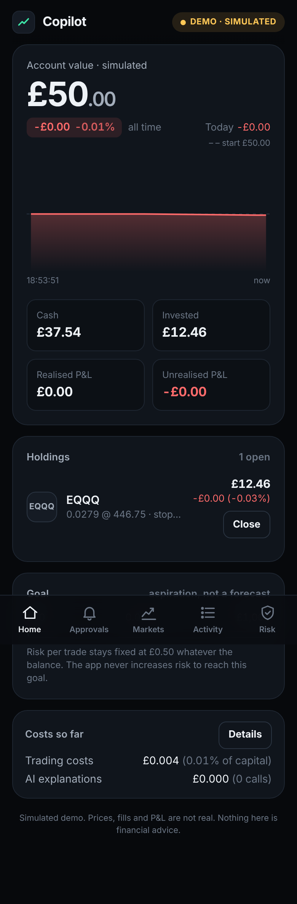
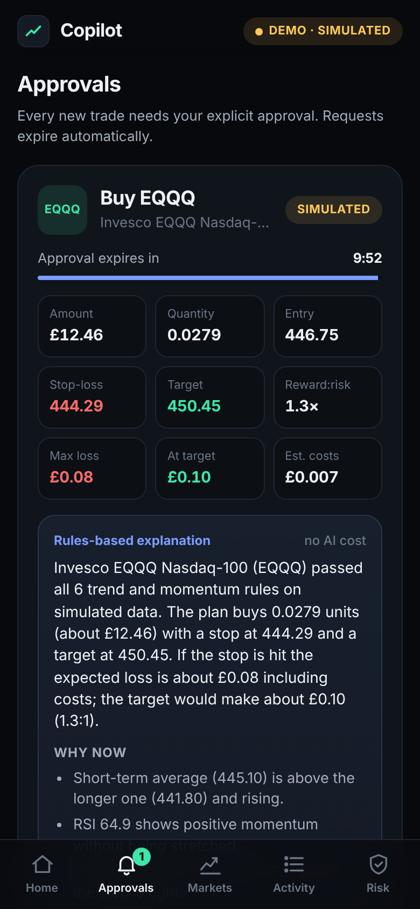
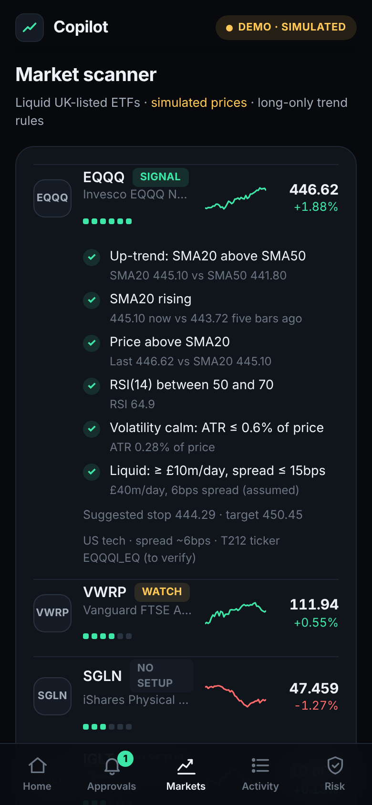
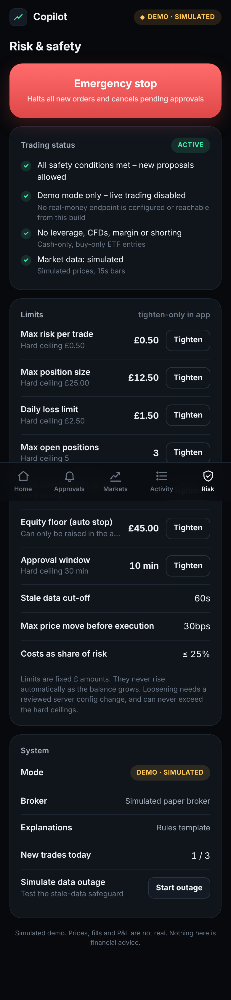

# AI Trading Copilot – Phase 1 (demo)

A mobile-first trading assistant for a small UK account. It scans liquid UK-listed ETFs, suggests trades using transparent rules, explains them in plain English (optionally with Claude), and **waits for you to approve every new trade on your phone**.

> **Demo only.** Prices are simulated, fills are simulated, and live trading is not implemented. Nothing here is financial advice. The £1,000 figure is an aspiration, not a forecast. The app never raises risk to chase it.

| Home | Approval | Scanner | Risk |
| --- | --- | --- | --- |
|  |  |  |  |

## Features

- £50 simulated account: balance, holdings, realised and unrealised P&L, equity chart
- Market scanner across 9 liquid GBP ETFs (VUSA, VWRP, ISF, VMID, EQQQ, CSP1, SGLN, IGLT, INRG)
- Six-rule, long-only trend strategy with every rule's value shown
- Explanations by Claude (server-side, budget-capped) or a free rules template
- Approvals that expire, with press-and-hold to approve
- Independent risk engine: £0.50 max risk per trade, £12.50 max position, 3 open positions, 3 trades/day, £1.50 daily loss limit, £45 equity floor, stale-data cut-off, price-drift check, duplicate protection
- Emergency stop (manual and automatic), close-all
- Trade history, hash-chained audit log, trading-cost and AI-cost tracking
- Prepared Trading 212 Public API client, locked to the **paper (demo)** host and disabled in Phase 1

## Quick start

```bash
cd ai-trading-copilot
npm ci
npm run build && npm start      # http://127.0.0.1:8787
npm test                        # 67 automated tests
npm run build:preview           # static, in-browser preview in dist/preview
```

Configuration is in [`.env.example`](.env.example). No credentials are needed.

## Layout

```
src/core/          shared engine (no Node/browser APIs)
  marketdata/      MarketDataProvider + simulated feed + ETF universe
  strategy/        indicators + rules-based signal
  risk/            limits (hard ceilings), sizing, independent validation
  ai/              explainer interface, budgeted fallback, rules template
  execution/       BrokerAdapter, simulated broker, idempotent ExecutionService
  portfolio/       ledger: fills → cash, positions, P&L
  audit/           hash-chained audit log
  engine.ts        orchestration
src/server/        Fastify API, config guardrails, file storage, Claude explainer, Trading 212 demo client
src/web/           React PWA
tests/             Vitest suites
docs/              ARCHITECTURE.md, DEPLOYMENT.md, screenshots
```

See [docs/ARCHITECTURE.md](docs/ARCHITECTURE.md) for the design and safety mapping and [docs/DEPLOYMENT.md](docs/DEPLOYMENT.md) for low-cost hosting.
